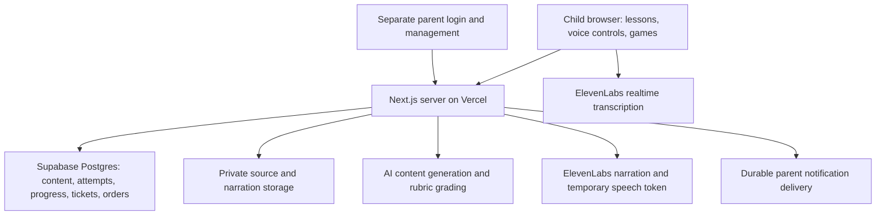

# Family Learning Arcade Technical Spec

Draft for alignment, not a completed implementation or deployment. The [PRD](plans/2026-10-07-1052-feat-family-learning-arcade-plan.md) owns product behavior and unresolved decisions. Its R-IDs are referenced below. This spec recommends how to implement those rules without carrying over the old game's architecture.

## Architecture recommendation

Use a single Next.js/React/TypeScript app on Vercel, Supabase Postgres for durable records, Supabase Auth for the parent, and Supabase private storage for curated sources and generated narration. Children use app-managed child sessions rather than needing email accounts. Credentials remain on the server.

Vercel's database offering is a Marketplace integration with providers including Supabase and Neon; provisioning a database is not the same as implementing login. Supabase combines the needed database, authentication, and storage capabilities. This is a fit recommendation, not a claim that Neon cannot support authentication. [Vercel Marketplace storage](https://vercel.com/docs/marketplace-storage), [Supabase Next.js guide](https://supabase.com/docs/guides/getting-started/tutorials/with-nextjs).

Keep game drawing and movement local. Learning gates, accepted answers, scores, rewards, and purchases are server-authoritative. The AI cannot write wallet amounts, change thresholds, or query arbitrary family records.

## Routes and access

Proposed child destinations are dashboard, current week, current chunk, daily mission, open play, prizes/history, and scores/family. Parent management lives under `/parent` and has no large child-navigation entry.

Parent authentication uses Supabase email sign-in. A parent enrolls a device and sets up the three child profiles with individual PINs. Child PIN handling, rate limiting, session expiry/revocation, and profile switching are app features to implement; they are not supplied automatically by a database integration. Issue opaque, revocable, secure HTTP-only child sessions bound to one child and family.

Child routes resolve the acting child from the session, not a browser-submitted child ID. Every query and mutation checks actor scope. The family leaderboard returns only display names/avatars and earned totals for that family. Parent routes require the separate parent session. Apply Supabase row-level security and minimum grants to exposed data, while recognizing that privileged server keys require explicit application authorization. [Supabase RLS](https://supabase.com/docs/guides/database/postgres/row-level-security).

Entering a child profile locks parent mode on that shared device and removes the parent management session from the browser. Reopening parent management requires fresh parent authentication; knowing the parent URL or retaining an old tab cannot grant access.

## Data model

| Record | Essential contents and invariant |
|---|---|
| Family / child profile | Parent ownership, display name, birth/grade information supplied by parent, reading/audio settings, timezone, learning days |
| Child session | Hashed opaque token, child/family binding, expiry and revocation; never a parent credential |
| Source asset | Original source, file reference, page/section, language, approved extraction, rights/provenance |
| Objective | Observable skill, domain, target evidence, prerequisite, age adaptation, delayed-check policy |
| Weekly lesson version | Child, objective blueprint, published content version, chunk order, test blueprint, narrator settings |
| Chunk version | Teaching blocks, examples, practice activities, assessment blueprint, estimated duration |
| Question instance | Frozen prompt, source/objective references, modality, rubric version, point maximum, server-only answer key, audio reference |
| Assessment attempt | Child, form version, immutable item sequence, first/retry relation, in-progress/submitted/pending-review/final disposition |
| Response / grade revision | Draft and locked answer versions, transcript lineage, awarded points, rationale, grader version, assistance, correction reason |
| Progress checkpoint | Teaching/item position, confirmed revision, current attempt, draft reference, last acknowledged save |
| Pass entitlement | Exact qualifying attempt and policy version; unique pass award for the logical chunk/test |
| Power-up inventory event | One-time pass reward and consumable use, linked to the chunk pass and game run; no duplicate charge from a retry |
| Game run | Child, game and seed/version, eligible question IDs, event sequence, active clocks, final run score and accuracy |
| Ticket ledger / wallet | Signed entries with unique qualifying event, balance, entry type, reversal linkage; lifetime earnings derived only from earning entries |
| Prize / order | Availability, value and ticket policy, price snapshot, confirmed/fulfilled/canceled order, child ownership, linked debit/refund |
| Notification outbox | Order event, destination, delivery state, retry count, deduplication key |

Publish versions rather than mutating active content in place. New weeks may be generated adaptively; a child resuming an existing assessment sees the same frozen form. Corrections to defective items create reviewed versions and grade revisions, not invisible history changes.

## Content and AI pipeline

For R2–R5 and R10–R13, prepare a weekly blueprint before prose generation. The input contains the child profile, baseline evidence, chosen sources, prior mistakes, taught objectives, vocabulary history, target thinking skills, and the approved schedule. Do not send unrelated sibling records or personal data to content providers.

The planner produces objectives, coverage, estimated activity lengths, and a question-type distribution. A writer creates original teaching prose, worked examples, and short narration blocks. The question generator produces structured instances with explicit evidence criteria, valid alternatives, source references, and answer keys. Validate schemas, arithmetic, source references, answer ambiguity, and expected total points before publishing. Parent-curated Torah and uncertain source extraction require review before children see them.

Generation and grading are separate responsibilities. Deterministic checks handle objective answers and supported mathematical forms. A structured grader handles open responses against the frozen rubric. User answers and uploaded source text are data, never instructions to the grader. A child's request to award tickets cannot change the grading policy.

Do not treat an AI confidence number or a second model's agreement as proof. Ambiguous results become pending review; a pending item cannot silently become zero or trigger a pass. Give the child a clear pause state and allow unscored review while the disputed item is resolved. Parents see the prompt, rubric, response, evidence, and proposed explanation. Keep a small evaluation set of accepted alternative answers, irrelevant answers, creative answers, and speech-transcription mistakes before selecting a model.

All weekly content and question assets should be prepared ahead of the child's session where possible. On-demand retries draw from a sufficiently broad validated pool or generate fresh equivalent forms before the next attempt starts. Never silently substitute easier material to obtain a pass.

## Assessment and progression implementation

Implement PRD R6–R10 using integer earned/max points and a versioned threshold. Under the proposed four-point rubric, compare `earned_points * 100 >= possible_points * 90`; require all 15 valid finalized items before finalizing the chunk. Score display rounding cannot affect this comparison.

Track chunk states as locked, available, teaching, practice, assessment-in-progress, submitted, grading, pending-review, needs-practice, and passed. A completed attempt transitions once to its finalized result. A new assessment form gets a new attempt ID. A pass entitlement references the qualifying attempt; it does not replace prior attempts. Schedule eligibility and prerequisite eligibility are separate fields until PRD Q1 is settled.

Hint use during a qualifying assessment offers a clear switch to practice before the hint is revealed. A hinted response cannot quietly remain part of an independent passing score. Resume saves and speech correction before feedback do not themselves count as academic assistance.

Finalizing a pass, awarding its one-time tickets and configured power-up charge, and recording its entitlement belong to one idempotent server transaction. Duplicate tabs or retrying a request return the same result. Consuming the power-up creates a separate unique inventory event; a retry, reload, or grade revision cannot award it twice. A grade correction revises the relevant evidence and recomputes derived summaries; it never creates duplicate rewards. Product policy for a reversed pass with downstream progress needs explicit handling before release rather than automatic destructive rollback.

## Autosave and interruption handling

For R9 and R27, save drafts after a short debounce and at transitions; save completed answers immediately. Use a per-checkpoint revision and reject stale writes. Show Saving, Saved, and Waiting for connection honestly. A local queue can preserve unsynced drafts, but the database remains authoritative for scores, gates, tickets, and checkout.

On reload, fetch the server checkpoint, reconcile newer local drafts, and resume the same content version. Do not persist a live microphone recording across navigation; preserve any completed transcript and clearly restart recording. An abandoned attempt remains incomplete, not a fabricated zero score. Save game seed and meaningful checkpoints rather than every animation frame. A resumed rewarded game must not replay previously credited pickups or learning awards.

If saving or grading fails, retain the response and offer retry. Do not show an unlocked screen until the server confirms the entitlement. A renderer failure may return the child to the learning screen or Match Studio without losing lesson progress; it must not fabricate a completed run.

## Voice and timed answers

Use ElevenLabs speech with alignment, mapping character timestamps to displayed words, including right-to-left text. Cache narration by exact text, voice, model, language, and settings. Recompute highlights against playback position when a child pauses, seeks, or changes speed. [Timed speech API](https://elevenlabs.io/docs/api-reference/text-to-speech/convert-with-timestamps).

For speech input, mint a single-use token on the authenticated server and connect the browser directly to ElevenLabs realtime transcription. Permanent provider secrets stay server-side. Use manual commitment; accumulate transcript segments until explicit Done or talk-key release. [Temporary tokens](https://elevenlabs.io/docs/api-reference/tokens/create), [realtime transcription](https://elevenlabs.io/docs/api-reference/speech-to-text/v-1-speech-to-text-realtime).

Implement the PRD voice-state sequence and one-replacement rule. Tag every recording and transcript with an answer-generation ID; late transcripts from superseded recordings are ignored. The server locks one final answer before grading. Microphone access requires HTTPS and permission; keep the typed alternative and stop capture on exit. Test young-child English, pronunciation of the assigned Hebrew text, and actual Gemara terms before claiming reliable recognition. Hebrew support does not establish reliable Aramaic support. [Model languages](https://elevenlabs.io/docs/overview/models).

Keep answer locking separate from feedback publication. During qualifying chunk and weekly assessments, save locked responses and withhold correctness until the entire form is submitted. In practice and daily mission modes, publish feedback after each locked response is graded. A shared voice component must receive an explicit assessment mode so it cannot leak an early verdict.

Daily mission timing needs two clocks: active driving and active answering. Pause the simulation and driving clock at a question gate. The answer clock starts after the full prompt and initial narration are ready. It includes thinking, typing, speaking, and child-controlled transcript review; exclude provider transport, transcription processing, transcript readback, and grading delays. A replacement does not reset elapsed active answer time. The available retry-initiation window is the lesser of the configured correction window and remaining question time.

At an answer deadline, freeze input and finalize an already submitted response. If a recording ended before the deadline, allow processing to finish; only the recorded-before-deadline content is eligible. If the deadline occurs while recording, stop at the deadline, transcribe captured audio, and permit acceptance of that captured transcript without a new answer. If there is no valid captured or submitted response, record a timeout. Technical interruption pauses or invalidates the checkpoint rather than applying an academic penalty. Complex open interpretation is excluded from V1 timed gates to keep this process predictable.

Before correctness is revealed, a child can flag a materially wrong transcript. Invalidate that checkpoint without a wrong-answer penalty and supply an equivalent replacement with no renewed speed bonus. Record the technical/disputed event separately; repeated trouble switches to typing or parent help instead of unlimited reward-bearing retries. A dispute after feedback requires parent review and does not allow another answer to the revealed question.

## Games and visual libraries

| Tool | Role | License and decision |
|---|---|---|
| Next.js / React | Lessons, navigation, store, parent screens, Match Studio | MIT; primary application framework |
| Phaser | Snake Trail and Rally Run scenes, input, sound, simple collisions | MIT; one game engine, lazy-loaded |
| Motion | Card motion, counters, score reveals, shelf transitions | MIT; one UI animation system |
| canvas-confetti | Short passing-score and prize celebrations | ISC; lazy-loaded and event-triggered |
| lucide-react | Navigation and action icons | ISC; label icons, import only used icons |
| Plain SVG | Rounded progress bars, score rings, small score histories | No chart dependency needed for the initial shapes |
| Recharts | More complex parent analytics if required later | MIT; evaluated, deferred |

Official sources: [Phaser templates](https://docs.phaser.io/phaser/getting-started/project-templates), [Phaser license](https://raw.githubusercontent.com/phaserjs/phaser/master/LICENSE.md), [Motion](https://motion.dev/docs/react), [Motion license](https://raw.githubusercontent.com/motiondivision/motion/main/LICENSE.md), [canvas-confetti](https://github.com/catdad/canvas-confetti), [Lucide license](https://lucide.dev/license), [Recharts](https://github.com/recharts/recharts).

Match Studio uses accessible React buttons; its relationship questions use the shared learning engine. Phaser mounts only in game routes. Its bridge emits checkpoint and finished-run events; it cannot set grades or ticket balances. Server-started runs snapshot eligible question IDs, seed, and scoring policy. Validate event ordering, duplicate event IDs, allowable pickups, and score bounds before awarding tickets; a browser-supplied total is not authoritative.

Rally Run should first use a small 2D or perspective-scaled road with simple obstacles and left/right controls. This supplies arcade depth without requiring real vehicle dynamics. Phaser's Canvas/WebGL paths provide options for broad device support, but specific effects still need testing. Do not add Three.js, Pixi, Rapier, or Matter alongside Phaser for V1. A later true-3D requirement can be evaluated against the validated race loop.

Use CSS for inset borders, bevels, button depth, restrained gloss sweeps, and graph paper. Add rounded SVG score charts and ticket silhouettes. Motion should respect `reducedMotion="user"`; confetti should enable `disableForReducedMotion`. Remove camera shake and repeated flash effects separately. Animation enhances a readable state change; it never carries the only success/failure signal. [Motion accessibility setting](https://motion.dev/docs/react-motion-config).

## Wallet, prizes, and parent notifications

For R17–R23, keep an append-only transaction ledger and a wallet balance updated atomically. Each earning has one unique qualifying-event ID and a lesson, mission, or open-play category. Sum those legitimate earning categories for the family leaderboard; exclude purchases, refunds, transfers, and administrative grants. Each purchase records the prize name, ticket price, and policy snapshot. A checkout transaction verifies the authenticated child, funds, prize availability, duplicate checkout ID, and expected price/policy version; then deducts tickets and creates a confirmed order and outbox event. If the displayed price changed, request a new child confirmation before spending. There is no reservation or parent approval stage.

Notification delivery happens after commit and retries independently. A failed email cannot cause a second debit or duplicate order. Parent notification destination/channel is an outstanding implementation choice; record the order in the parent area regardless. Fulfillment changes the order state without touching earnings. Cancellation creates a linked refund once. Refund entries restore balance without increasing lifetime earned tickets. [Postgres transactions](https://www.postgresql.org/docs/current/tutorial-transactions.html).

The reward policy is versioned and explicit: approved rate, per-category caps, learning-day rules, and prize valuation. Before enabling real rewards, simulate full, typical, and interrupted weeks for each child, including retries, missions, open play, and small purchases. The PRD's prize timeline applies to a child saving tickets, not to one who spends them throughout the period.

## Deployment, checks, and build sequence

Vercel hosts the app; durable state lives in Supabase. Vercel now documents WebSocket support in public beta with function-duration limits. This design does not need that beta because speech streams directly to ElevenLabs. Keep development/preview databases and prize ledgers separate from production. Pin compatible stable dependency versions at implementation time. [Vercel WebSockets](https://vercel.com/docs/functions/websockets).

Suggested build sequence after product alignment:

1. Grayscale navigation, teaching, assessment, below-threshold result, fresh retry, unlock, weekly test, and checkout with fixture data.
2. Real login, versioned lesson content, autosave, deterministic scoring, strict progression, and immutable attempt history.
3. ElevenLabs playback/highlighting and spoken-answer correction, then validated open-response grading.
4. Match Studio, Snake Trail, and the Rally Run prototype; daily mission is a mode of Rally Run, not a fourth game.
5. Reward-policy simulation, atomic wallet/store, notifications, family rankings, and parent review.
6. Tone-on-tone visual polish, charts, confetti, sound, mobile and reduced-motion checks, then a family pilot.

| Required check | Pass condition |
|---|---|
| Progression boundaries | 53/60 fails; 54/60 passes; missing/pending items cannot pass; calendar changes do not bypass prerequisites |
| Grading consistency | Accepted creative alternatives receive rubric-consistent credit; uncertain evidence is visible for review |
| Saved history | Original, retry, incomplete, and corrected results remain distinguishable |
| Interrupted session | Reload and network recovery resume the right item and draft without duplicate credit |
| Voice correction | Partial transcripts cannot submit; late transcripts cannot overwrite locked answers; technical failures and pre-feedback disputed transcripts do not penalize |
| Timing fairness | Narration/provider delay never consumes answer time; a retry cannot restart the answer clock |
| Reward integrity | Duplicate award, concurrent checkout, and notification retries never duplicate tickets or spending |
| Access control | One child's session cannot mutate a sibling's wallet, open locked content, or access parent controls |
| Daily review eligibility | Games draw only from completed teaching, including for children behind schedule |
| Device behavior | Keyboard, touch, microphone permissions, RTL text, reduced motion, and renderer failure work on actual family devices |
| Duration and economics | Pilot measures chunk duration; reward simulation verifies the approved prize timeline |

The current design has not passed these implementation checks. Library suitability is researched; performance, voice quality, child usability, and the final economy remain to be tested.
